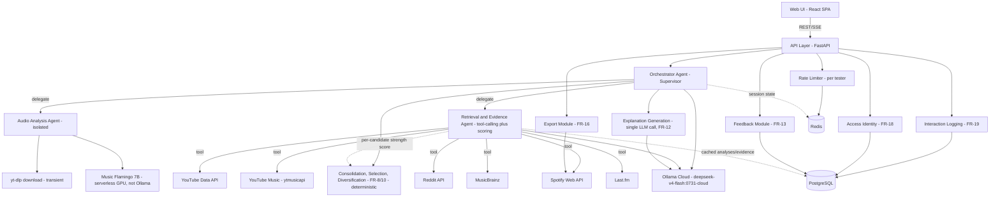

# Project Orchestra — System Architecture

**Status:** Draft v0.1 — first pass, pending confirmation on the open items in Section 9.
**Basis:** SRS v2.0 (`srs-01.md`–`srs-04.md`), plus the operator-context decisions logged in the Obsidian vault (2026-07-18).

---

## 1. Scope Recap

The requirements that actually shape this design, distilled:

- Solo-built, personal/portfolio project. Deployed for a bounded, invited tester cohort recruited via LinkedIn — not a general-public product, not commercialised (SRS §10).
- LLM backend: **Ollama Cloud**, model `deepseek-v4-flash:0731-cloud` — chosen for low cost, API key held server-side only (operator decision, not in SRS). Originally `kimi-k3:cloud`; swapped out during Phase 3 build after it failed live with a 402 — that model requires paid "extra usage" beyond the plan in use. No confirmed second model yet, so primary and fallback are currently the same model (see PROJECT_STATUS.md §6.7).
- Input-song audio is downloaded (YouTube, via `yt-dlp`) and run through an audio-understanding step to produce a natural-language caption — input song(s) only, never candidates (FR-3.2, FR-3.4).
- Candidates (50–100 per FR-6.3) are evaluated on non-audio evidence only: metadata, community discussion, playlist co-occurrence (FR-7, FR-7.3).
- Multi-provider retrieval: Spotify, YouTube, YouTube Music, Reddit, MusicBrainz, Last.fm (FR-6) — provider set is meant to be extensible (NFR-5), not fixed.
- Passwordless, email-verified access (FR-18); no password storage.
- Full interaction logging — query, conversation, recommendations, tool calls, feedback — keyed to identity, retained for operator study (FR-19). Explicitly **not** used to auto-personalize a returning tester's recommendations.
- Session behaviour (conversational refinement, in-session dedup) is ephemeral and does not carry across sessions (FR-14, FR-15, NFR-11).
- Per-tester usage limits sized to Ollama Cloud capacity (SRS §10).
- Latency budget up to ~60s per request; quality over speed (NFR-1).
- Spotify OAuth needed at export time (FR-16) — per-tester, standard authorization-code flow.
- Modularity is a stated requirement, not a nicety: input understanding, music understanding, retrieval, evidence collection, ranking, explanation, export, and feedback must stay conceptually independent (NFR-8).

---

## 2. Architecture Pattern: Modular Monolith, Supervisor Orchestration Inside

Two separate decisions, easy to conflate, worth keeping apart:

- **Deployment topology: one process.** Not microservices — a solo developer gains nothing from network boundaries and pays for them in operational overhead (deploys, service discovery, cross-service tracing) a single low-traffic instance doesn't need.
- **Reasoning/orchestration topology: Supervisor, not a single agent.** This isn't the earlier draft's flat pipeline of "one orchestrator inlining everything." It was re-run through the agent-designer skill's deterministic planner against Project Orchestra's actual task list and constraints (60s budget, tight per-task cost, fault tolerance required) rather than picked by feel — it scored **Supervisor pattern**, and that's the right call here on domain grounds too: query understanding/hypothesis generation (needs judgment, low tool count) is a different job from multi-provider retrieval (needs autonomy over *which* of 6 providers to hit and how hard, i.e. genuinely agentic tool-calling) is a different job again from turning evidence into prose. Collapsing those into one agent's tool list was the actual problem with the first draft, not the single-process deployment.

Three agent/logic roles, all running inside the one deployed process:

1. **Orchestrator (Supervisor)** — owns query understanding (FR-2), hypothesis generation (FR-4), delegates to the two specialists below, and assembles the final batch. This is the "main agent."
2. **Retrieval & Evidence Agent** — a genuine tool-calling agent, equipped with one tool per provider (schemas below). It decides *which* providers to query and how extensively (FR-6.1/FR-6.2) — this is the actual "agentic search" piece — and, per-candidate, **judges the evidence it gathers into a recommendation-strength score** (FR-9.2's "holistic" weighing across heterogeneous evidence types is qualitative judgment, not arithmetic, so it belongs here rather than in a separate step re-reading the same evidence).
3. **Audio Analysis Agent** — small, single-purpose, isolated on its own interface: resolve input song → `yt-dlp` download → audio-caption call → discard audio. Kept separate for the same reason as the original draft (swappable if the audio-model backend or the download approach changes), but now explicit as its own agent boundary rather than a module inside a monolithic orchestrator.

**Ranking split into two distinct jobs, not one.** Evidence *scoring* (job 1, above) is judgment and belongs to the Retrieval & Evidence Agent. Selection and diversification (job 2 — consolidating duplicate candidates, sorting by score, then enforcing FR-10's crisp numeric rules: ≤3 songs per artist, exclude covers/live unless requested, deprioritize remixes) is **deterministic Python, not an agent** — these are fully-specified rules, not decisions, and asking an LLM to hold a hard constraint like "≤3 per artist" while reasoning over 50-100 already-scored items is a known reliability failure mode for no judgment benefit, plus it would mean re-sending the whole evidence set through the model a second time for pure cost with nothing gained. Explanation generation (FR-12) is a **direct, non-autonomous LLM call** (single prompt → prose, no tool loop) invoked by the Supervisor once selection is done.

Net shape: 2 real agents + 1 supervisor (one of which, Retrieval & Evidence, also owns scoring) + a deterministic selection pass + one templated LLM call for prose. Not 1 monolith, not 8 microscopic agents, and not agentic constraint-enforcement where a sort-and-filter does the job for free.

---

## 3. Component Overview



**Roles**, mapped to NFR-8's list so responsibilities stay distinct:

| Role | Kind | Responsibility | Notes |
|---|---|---|---|
| Access Identity | Deterministic | Email verification (magic link), session token issuance | No password. Keys the rate limiter and the log. |
| Orchestrator (Supervisor) | Agent | Query understanding (FR-2), hypothesis generation (FR-4), delegation, final assembly | Ollama Cloud, tool-calling to invoke the two specialists below. |
| Retrieval & Evidence Agent | Agent (tool-calling) | Decides which of the 6 providers to query and how much (FR-6.1/6.2), executes searches, tags evidence with provenance (FR-7/FR-7.1), and judges each candidate's evidence into a recommendation-strength score (FR-9.2) | Tool schemas validated via the agent-designer skill — see `retrieval-agent-tool-schemas.json`. This is the extension point for NFR-5: a new provider is a new tool, not a new agent. Scoring lives here, not in a separate step, so evidence only gets read once. |
| Audio Analysis Agent | Agent (isolated) | Resolve input song → audio → caption (FR-3.2/3.4) | The swappable module from the original draft, now an explicit agent boundary. Needs a non-Ollama backend — see §9. |
| Consolidation/Selection/Diversification | Deterministic | Merge duplicate candidates (FR-8), sort by the agent-produced strength score, then enforce FR-10's crisp rules (≤3/artist, exclude covers/live, deprioritize remixes) | FR-8/10. No LLM involved — these are fully-specified rules, not judgment, and it's the easiest thing here to unit test. |
| Explanation Generation | Single LLM call (not an agent) | Turn strongest evidence into human-readable prose | FR-12. No autonomy needed — one prompt in, prose out. |
| Export | Deterministic | Spotify playlist write (OAuth), CSV, JSON | FR-16. |
| Feedback | Deterministic | Collect batch feedback, apply in-session adaptation | FR-13. |
| Interaction Logging | Deterministic | Trace everything, keyed to identity | FR-19. Write-only — nothing reads it back into a live request. |
| Rate Limiter | Deterministic | Per-tester usage caps against Ollama Cloud capacity | Redis counters, sliding window or token bucket. |

---

## 4. Tech Stack

| Layer | Choice | Why |
|---|---|---|
| Language | Python | Matches your stated preference; also just the right tool here — every provider SDK, `yt-dlp`, and the Ollama client are Python-native, and there's no polyglot benefit at this scale. |
| API framework | FastAPI | Async support matters — the discovery flow fans out to up to 6 providers concurrently inside a 60s budget. Free OpenAPI docs, minimal ceremony for a solo dev. |
| Frontend | React SPA (Vite), not Next.js | This is an authenticated tool behind a login, not a public content site — there's no SEO to buy with SSR. A plain SPA is less hosting surface and faster to ship. (Swap to Next.js if you specifically want that on your resume — reasonable, just not necessary.) |
| Primary datastore | PostgreSQL | Holds identities, the FR-19 interaction log, feedback, and durable cached song analyses/evidence (§17). JSONB columns are a good fit for the log's variable-shaped tool-call traces without needing a document DB. Also the more resume-recognizable choice than SQLite. |
| Session/cache layer | Redis | In-session conversation state and recommendation history (FR-14/FR-15) live here with a TTL — matches "ephemeral, gone when the session ends" exactly, no manual cleanup logic needed. Also backs the per-tester rate limiter (§ above). |
| Auth | Passwordless magic link + short-lived JWT | Satisfies FR-18 (no password) directly. Needs a transactional email sender (e.g. Resend, or plain SMTP) — pick whichever's free tier covers a beta-sized tester list. |
| LLM backend | Ollama Cloud — `deepseek-v4-flash:0731-cloud` (primary and fallback, for now) | Picked for low per-token cost on Ollama Cloud's usage-based pricing. Used for the Orchestrator (query understanding, hypothesis generation, delegation), the Retrieval & Evidence Agent (tool-calling + scoring), and Explanation generation. Audio captioning is a separate backend — see below. `kimi-k3:cloud` was the original pick but failed live in Phase 3 with a 402 (needs paid "extra usage" beyond the account's plan) — swapped to `deepseek-v4-flash:0731-cloud`, confirmed working. Since Ollama Cloud's interface is identical across `:cloud` models, swapping primary/fallback is a config change, not a code change — a distinct second fallback model is still worth picking once one's confirmed to work under the current plan. |
| Audio-understanding backend | Music Flamingo 7B (`nvidia/music-flamingo-hf`) on serverless GPU (Modal, or RunPod Serverless as fallback) | Resolves §9 item 1. Confirmed via hands-on test on the model's HF Space — captions are rich enough (chords, structure, instrumentation, mood) to give Hypothesis Generation real material to work with, not just a genre tag. Serverless/scale-to-zero keeps cost aligned with §7's "few dollars a month" target; no dedicated always-on GPU needed for a bounded tester cohort. Single endpoint contract: audio in, caption text out — see §9 for the cold-start tradeoff against NFR-1's 60s budget, and the noncommercial-license check still needed before testers go live. |
| Audio acquisition | `yt-dlp` | Only technically viable path per the earlier research pass. Process-and-discard, never persisted (matches §17's cache philosophy). |
| Provider clients | Direct REST calls / official SDKs where available (`spotipy`, `ytmusicapi`, `musicbrainzngs`, PRAW for Reddit) | One adapter module per provider behind a shared interface, so adding/removing a provider doesn't ripple through Retrieval or Evidence Collection (NFR-4/5). |

---

## 5. Data Model (sketch)

Postgres, minimal normalized shape — this will get refined once you're actually writing queries, but the entities are stable given the SRS:

```
identities
  id (pk), email, created_at, spotify_oauth_token (encrypted, nullable)

sessions
  id (pk), identity_id (fk), started_at, ended_at
  -- ephemeral conversational state itself lives in Redis, keyed by session id;
  -- this row exists so FR-19's log has something durable to hang off

interaction_events            -- FR-19, the append-only trace
  id (pk), session_id (fk), identity_id (fk), created_at
  event_type (query | tool_call | recommendation | feedback | export)
  payload (jsonb)              -- shape varies by event_type

feedback
  id (pk), session_id (fk), reaction (loved_it | pretty_good | mixed | missed), comment (nullable)

cached_song_profile            -- §17 durable cache
  song_key (pk, normalized artist+title or provider id), profile (jsonb), updated_at

cached_evidence
  candidate_key (pk), source, evidence (jsonb), fetched_at
```

`interaction_events` as a single append-only table with a `jsonb` payload, rather than one table per event type, keeps FR-19 honest to its own spirit — "trace everything" — without a schema migration every time a new tool gets added to Retrieval.

---

## 6. Request Flow — Song-Based Discovery (maps to SRS Flow 1)

1. Tester authenticates (magic link) → session created, rate limit checked.
2. Tester submits 1–5 songs. **Input Audio Analysis** resolves each to YouTube audio via `yt-dlp`, runs it through the audio-understanding backend (Music Flamingo 7B on serverless GPU — see §4), discards the audio, keeps the caption.
3. **Query Understanding** + **Hypothesis Generation** turn the caption(s) into search hypotheses. If songs are stylistically divergent, hypotheses are clustered rather than blended (FR-1.2 amendment).
4. **Multi-Provider Retrieval** fans out to providers concurrently, governed by the retrieval budget (FR-6.2), targeting ~50–100 unique candidates (FR-6.3).
5. **Evidence Collection** gathers non-audio evidence per candidate, tagged with provenance (FR-7.1).
6. **Consolidation** merges duplicate candidates across providers (FR-8); **Ranking** scores by aggregated evidence strength (FR-9, holistic — no fixed source-count floor per the v1.1 clarification); **Diversification** applies artist/cover/live/remix constraints (FR-10).
7. **Explanation Generation** produces the human-readable rationale per recommendation (FR-12).
8. Result batch returned to the tester; every step along the way is written to `interaction_events` (FR-19) as it happens, not batched at the end — so a request that errors out mid-flow still leaves a usable trace.
9. Tester gives batch feedback (FR-13) → logged, and applied to *this session's* remaining interactions only.
10. Tester may export (FR-16) — Spotify OAuth flow triggered here if not already linked.

---

## 7. Hosting & Deployment

**Recommendation: a small managed host, not your laptop, for the duration of the testing window.**

Reasoning: you need the thing reachable and up while testers are actually trying it, and your laptop is also your Avasoft/Mycelen machine — sleep, reboots, and resource contention will show up as "the demo was down" at exactly the wrong moment. A cheap option (Fly.io, Railway, or Render — all have free/low-cost tiers that comfortably fit "personal project, no budget," and bundle Postgres + Redis alongside the app) removes that risk for a few dollars a month at most, and it's also a better resume line than "runs off my laptop."

If you want zero recurring cost and are fine with the availability tradeoff, laptop-hosting behind a tunnel (Cloudflare Tunnel or similar, so you're not exposing your home IP directly) is workable for a short, announced testing window — just not for anything open-ended.

This is your call to make, not mine — flagging it as still open in §9.

---

## 8. Rate Limiting & Cost Control

- Per-identity sliding-window counter in Redis (e.g., N requests/day, N concurrent), sized against whatever Ollama Cloud's plan actually allows — needs your account's real limits to size concretely.
- A global daily cap as a backstop, independent of per-tester limits, so a handful of enthusiastic testers can't collectively blow the budget even if each is individually under their own cap.
- YouTube search/download calls should get their own budget tracking separate from Ollama, since quota exhaustion there (10k units/day on the official Data API) is a real, independently-hit ceiling.

---

## 9. Open Items Needing Your Call

1. ~~Audio-understanding backend~~ — **resolved**: Music Flamingo 7B (`nvidia/music-flamingo-hf`), hosted on serverless/pay-per-use GPU (Modal, or RunPod Serverless as fallback). See §4. Two follow-ups before this ships to real testers, not blockers to building against:
   - **Cold-start risk against NFR-1's 60s budget.** A 7B multimodal checkpoint cold-starts in the ~20-45s range on serverless GPU — that alone could eat most of the per-request budget before Query Understanding, the 6-provider fan-out, and Explanation run. Mitigate by tuning the container's idle-timeout (stay warm ~10-15 min after last hit, since a tester's multi-song session will hit it more than once) rather than instant scale-to-zero. Needs empirical measurement once deployed.
   - **License check.** Checkpoints ship under NVIDIA's OneWay Noncommercial license (plus Qwen2.5's own terms underneath, since Music Flamingo is built on it). Project Orchestra's non-commercial, invited-cohort framing (§1) almost certainly clears this, but read the actual license text before testers go live — don't just assume.
   - **Considered and rejected: Audio Flamingo Next (AF-Next).** NVIDIA's newer (Apr 2026), broader-scope successor — same 7B size, but generalist across speech/sound/music rather than a music specialist, and trained in part on Music Flamingo's own outputs. It edges Music Flamingo on a few benchmarks (MuChoMusic, SongCaps correctness, Medley-Solos-DB), but the only one of those with independent third-party weight — SongCaps — turned out to be an unreleased, NVIDIA-internal eval (open GitHub issue asking for the dataset has sat unanswered since Nov 2025; no outside lab, including Qwen's, has ever run it). On MusicCaps — the one externally-established, publicly-downloadable captioning benchmark — Music Flamingo has a real reported score (8.8) and AF-Next doesn't report one at all. Given the Audio Analysis Agent only ever handles music (no speech/sound need), the music specialist stays the pick. Cheap to revisit later: same size, same license family, same hosting plan, so swapping is low-cost if a legitimate third-party SongCaps comparison shows up or an in-house A/B on real tester tracks says otherwise.
2. ~~Tool-calling support for the agentic retrieval loop~~ — **resolved**: you've confirmed Ollama Cloud's models are tool-calling capable, so the Retrieval & Evidence Agent is designed as a genuine tool-calling agent (§2/§3), not deterministic Python. Provider tool schemas for it are drafted and validated in `retrieval-agent-tool-schemas.json` (6 tools, one per provider — generated and checked via the agent-designer skill).
6. ~~Specific Ollama Cloud model~~ — **resolved, then revised live in Phase 3**: `kimi-k3:cloud` was picked first but failed with a 402 (needs paid "extra usage" the account's plan doesn't include) the first time it was actually called. Now `deepseek-v4-flash:0731-cloud`, confirmed working, used as both primary and fallback until a distinct second working model is picked. See §4.
3. **Final hosting call** — managed host vs. laptop (§7). Options + full cost comparison incoming in a separate doc, per your ask.
4. **Provider build order** — I'd sequence Spotify + YouTube + MusicBrainz first (most stable), Reddit second, YouTube Music (`ytmusicapi`) last given it's the least stable dependency of the six. Agree, or do you want YouTube Music sooner?
5. **Genre-specific evidence is thin** — you flagged this. None of the current 6 providers are genre/style specialists; the SRS itself already anticipates Discogs, Bandcamp, and SoundCloud as future providers (§16 of srs-03.md). Discogs in particular has a real, well-documented API and a much more granular style/genre taxonomy than any of the current six — worth promoting from "future" to a v1 candidate. Researching provider terms alongside the cost/hosting work.
