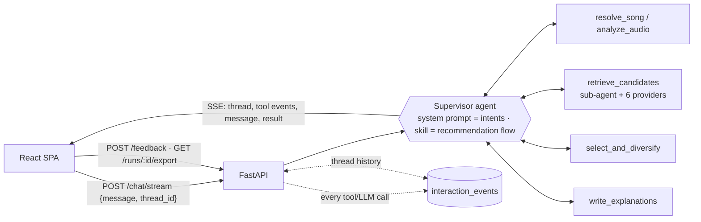

# 1. System overview

**Product:** you give 1–5 songs; the system works out *why* they appeal, searches
several independent sources for songs with the same feeling, and returns
recommendations each with an explanation grounded in the evidence found.

## One request, end to end



The user's free-text message goes to one **supervisor agent** (`agents/orchestrator.py`) that decides
what a message needs and which tools to call. Its system prompt (`prompts/orchestrator_system_prompt.md`)
defines the kinds of request; the recommendation workflow is a loadable skill
(`skills/recommendation/SKILL.md`). None of it is in code. See doc 2.

## Who decides what

| Piece | Who decides | Why |
|---|---|---|
| What the message means, which tools, in what order | Supervisor LLM, following its prompt | Free text, links, descriptions, follow-ups all need judgment |
| Which providers to query, how hard, candidate scoring | Retrieval sub-agent (tool-calling LLM) | Open-ended search |
| Selection rules (dedupe, filter, ≤3/artist, no repeats) | Plain Python tool | Hard rules must be exact and testable |
| Explanations | LLM call in a tool | Prose from evidence |
| Audio (YouTube lookup + caption) | Plain code in a tool | Fixed procedure, best-effort |

The final response is assembled from the tools' stored results, not from model text.

## Layers (backend)

```
api/routes   HTTP only: parse request, call a service/agent, shape response
agents/      LLM-driven stages (audio, hypothesis, retrieval, explanation) + orchestrator
tools/       LangChain tool wrappers the retrieval agent can call
clients/     One adapter per outside service (Spotify, Spotify playlists, Reddit via Composio, YouTube, …; the old PRAW client is in `backend/archive/reddit/`)
services/    Plain logic: selection, auth, rate limit, export, run lookup, logging
schemas/     Pydantic request/response/LLM-output models
models/      SQLAlchemy tables
prompts/     System prompts as .txt files
```

Rule of thumb: routes never contain logic; services never import FastAPI; clients
never know about agents.

## Infrastructure

- **Postgres** (port 5433): identities, sessions, `interaction_events`, `feedback`.
- **Redis**: single-use magic-link tokens, rate-limit counters.
- **LLM:** Ollama Cloud (`glm-5.3-flash:cloud`); primary and fallback are
  currently the same model.
- **Frontend:** Vite dev server proxies `/api` to the backend on :8000.

## Review checklist
- Can you say what is LLM-driven and what is code? (table above)
- Do you agree the selection rules should stay plain code behind a tool?
- Are you comfortable with primary == fallback model (no real fallback)?
